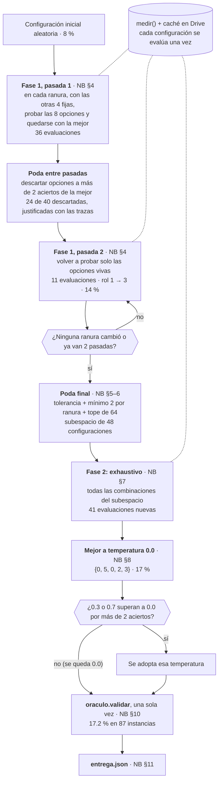
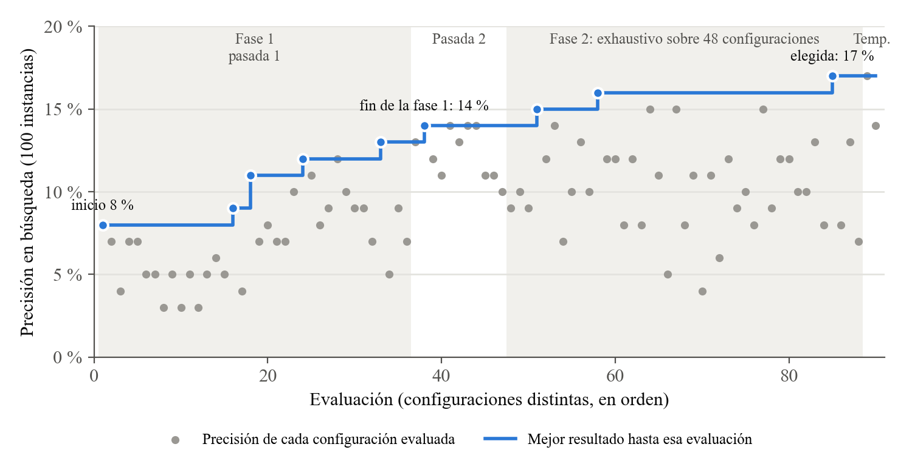

# Manual técnico — Solución base del Proyecto Oráculo (ADAG1)

| | |
|---|---|
| **Curso** | Análisis y Diseño de Algoritmos · 2026-B · Universidad de Caldas |
| **Subproyecto** | 1 — Proyecto Oráculo: configuración de prompt con un oráculo |
| **Grupo** | ADAG1 · **Integrante:** Tania Botina |
| **Versión** | Primera entrega, solución base (semana 2), rama `main` de https://github.com/tbotina/ADA-2026-2-GP01 |

Este manual explica cómo está construida la solución base y cómo reproducir su ejecución. El planteamiento formal, la prueba de NP-dureza y el análisis de muestreo están en el informe. Para una vista rápida del repositorio, ver el [README](README.md).

**Estado:** solución base, todavía no terminada. Lo que falta está en la §5.4.

## 1. Entorno

| Componente | Versión usada | Nota |
|---|---|---|
| Plataforma | Google Colab, GPU **NVIDIA Tesla T4** (15 GB) | La GPU es obligatoria: sin CUDA, `cargar_modelo` falla. |
| Python | 3.13.16 | El de Colab en la corrida del 30–31 oct 2026. |
| torch | 2.11.0+cu130 | Viene preinstalado en Colab. |
| transformers | 5.22.1 | Lo instala la celda 1. |
| Modelo | `qwen17b` → `Qwen/Qwen3-1.7B`, fp16, 3.44 GB de VRAM | Se descarga de Hugging Face. |
| Sistema operativo | Linux de Colab | Probado solo ahí. |

La celda 1 de cada notebook instala las **dependencias**:

- `bitsandbytes>=0.46.1`, `transformers`, `accelerate`;
- `nltk` con `punkt`, `punkt_tab`, `averaged_perceptron_tagger` y `averaged_perceptron_tagger_eng`, que se bajan a mano;
- `spacy` con `en_core_web_sm`, `emoji`, `langdetect`, `immutabledict`;
- un clon de `allenai/open-instruct`, de donde salen los verificadores de restricciones del oráculo.

`pandas` y `matplotlib` ya vienen en Colab.

**Sin GPU** corren las pruebas locales, en cualquier sistema operativo: `pruebas/probar_entrega.py` con Python ≥ 3.8 y solo la biblioteca estándar, y `pruebas/probar_busqueda.py` con pandas además.

## 2. Arquitectura

```
ADA-2026-2-GP01/
├── entrega.json                     configuración entregada (grupo, semana, config)
├── notebooks/
│   ├── busqueda.ipynb               búsqueda documentada, con salidas
│   ├── registro_evaluaciones.csv    las 90 configuraciones evaluadas
│   └── evaluacion.ipynb             carga entrega.json y la evalúa, con salidas
├── pruebas/
│   ├── probar_entrega.py            pruebas de entrega.json y de coherencia (sin GPU)
│   └── probar_busqueda.py           pruebas del algoritmo con oráculos falsos (sin GPU)
├── figuras/
│   ├── generar_curva.py             dibuja la curva desde el registro
│   └── curva_busqueda.png           curva de la búsqueda
├── README.md · MANUAL_TECNICO.md
└── oraculo.py · ayudas.py · datos_visibles.json · proyecto_oraculo.ipynb · README_curso.md   (del curso)
```

| Archivo | Responsabilidad | Autor |
|---|---|---|
| `oraculo.py` | **Caja negra.** Arma el prompt a partir de la configuración, genera con el modelo, verifica las restricciones, guarda la caché y devuelve un `Resultado`. Se usa solo su API pública: `Oraculo`, `evaluar`, `validar`, `espacio`, `RANURAS` y `TEMPERATURAS` | Curso |
| `ayudas.py` | `cargar_modelo`, `cargar_datos`, `dividir`, `ver_prompt`, `curva` y `entrega` | Curso |
| `datos_visibles.json` | 450 instancias: 100 de `busqueda`, 87 de `validacion` y 263 `descartada` | Curso |
| `notebooks/busqueda.ipynb` | Búsqueda heurística de la configuración: fase 1, poda, fase 2, temperatura, validación y entrega (§3) | Grupo |
| `notebooks/registro_evaluaciones.csv` | Una fila por configuración evaluada, en el orden en que se probó | Grupo, generado por la búsqueda |
| `notebooks/evaluacion.ipynb` | Lee y valida `entrega.json`, y evalúa la configuración sobre el conjunto de prueba (validación) | Grupo |
| `entrega.json` | Resultado entregado. Lo escribe `ayudas.entrega` en la sección 11 de la búsqueda | Grupo |
| `pruebas/probar_entrega.py` | Validez de `entrega.json`, casos inválidos con resultado esperado y coherencia entre archivos | Grupo |
| `pruebas/probar_busqueda.py` | Ejecuta el código de la búsqueda contra oráculos falsos con resultado conocido | Grupo |

Los notebooks **descargan** `oraculo.py`, `ayudas.py` y `datos_visibles.json` del [repositorio del curso](https://github.com/DanielMelo404/Proyecto-Oraculo-AyD) al ejecutarse. Las copias de este repositorio están solo como referencia.

## 3. Funcionamiento

### 3.1 Flujo

```
cargar_modelo("qwen17b") → cargar_datos() → dividir() → Oraculo(modelo, busqueda, validacion, cache, lote=32, presupuesto=64M)
  → fase 1: ascenso por coordenadas, 2 pasadas    (oraculo.evaluar sobre las 100 de búsqueda)
  → poda por evidencia de trazas                  (subespacio ≤ 64)
  → fase 2: exhaustivo sobre el subespacio
  → temperatura sobre la mejor
  → oraculo.validar(elegida)                       (87 de validación, una sola vez)
  → ayudas.entrega("ADAG1", elegida, 2)            → entrega.json
```

### 3.2 Estructuras de datos

- **Configuración:** `dict` con `rol`, `estrategia`, `formato`, `estilo` y `cierre` (enteros de 0 a 7), más `temperatura` (0.0, 0.3 o 0.7). Hay $8^5 = 32\,768$ configuraciones por temperatura.
- **Resultado** del oráculo:
  - `precision` es la fracción de instancias resueltas. Es todo o nada: una instancia vale 1 solo si la respuesta cumple todas sus restricciones.
  - `n` es el número de instancias.
  - `trazas` es una lista de `{id, violo, salida}`, una por cada instancia fallada. `violo` es la **primera** restricción incumplida, por ejemplo `keywords:frequency`.
- **Estado de la búsqueda** (sección 3 del notebook):
  - `RESULTADOS` mapea la clave `(rol, estrategia, formato, estilo, cierre, temperatura)` a su `Resultado`. Así cada configuración se evalúa una sola vez.
  - `REGISTRO` guarda una fila por configuración y se escribe en el CSV después de cada evaluación.
  - `VIVAS` tiene las opciones de cada ranura que siguen en carrera.
  - `BARRIDOS` guarda el último barrido de cada ranura.
  - `CANDIDATAS` es el resultado de la poda.
- **Caché del oráculo:** un archivo JSON (`/content/drive/MyDrive/oraculo_cache.json`) indexado por modelo, configuración, instancia y semilla. Repetir una consulta no gasta GPU, y por eso el notebook se puede reanudar tras una desconexión.

### 3.3 Algoritmo de búsqueda

El flujo completo, con las cifras de la corrida entregada:



«NB §k» es la sección del notebook de búsqueda. Las líneas punteadas indican que todas las evaluaciones pasan por `medir` y la caché.

Toda consulta pasa por `medir(config)`. Si la configuración ya está en `RESULTADOS`, la devuelve sin evaluar. Si no, la evalúa sobre las 100 instancias de búsqueda con semilla 1, la registra y la guarda. **Aciertos** = `round(precision · n)`.

**Parámetros:**

| Parámetro | Valor | Para qué |
|---|---|---|
| `SEMILLA` | 2026 | Fija la configuración inicial: `{rol:1, estrategia:7, formato:1, estilo:7, cierre:6}`. |
| `SEMILLA_ORACULO` | 1 | Semilla de generación del oráculo. |
| `TOLERANCIA` | 2 aciertos | Con $n = 100$, una diferencia de 1–2 aciertos no se toma como evidencia. |
| `PASADAS` | 2 | Número de pasadas de la fase 1. |
| `MAX_SUBESPACIO` | 64 | Tope de configuraciones de la fase 2. |

**Fase 1: ascenso por coordenadas** (Algoritmo 2.3.2 del enunciado).

```
actual ← INICIO;  VIVAS[j] ← {0..7} para cada ranura j
para p = 1, 2:
    para cada ranura j en (rol, estrategia, formato, estilo, cierre):
        evaluar actual con cada opción o ∈ VIVAS[j] en la ranura j (las otras cuatro fijas)
        actual[j] ← opción con más aciertos            (en empate se conserva la actual)
        si p = 1:  VIVAS[j] ← opciones a ≤ TOLERANCIA de la mejor (mínimo 2)
                   las demás se descartan y quedan registradas con las familias en que fallan de más
    si p > 1 y ninguna ranura cambió: parar (convergencia)
```

Se hacen dos pasadas por el **enmascaramiento**. Con evaluación todo-o-nada, mientras las otras ranuras dañan la respuesta, el beneficio de mejorar una sola ranura no se ve. Por eso una *pérdida* sí es evidencia de daño, pero un *empate* no lo es. La pasada 1 descarta solo lo que pierde, y la pasada 2 vuelve a evaluar lo que sobrevive en un contexto más limpio.

**Poda.** En el último barrido de cada ranura sobreviven las 2 mejores opciones y todas las que estén a `TOLERANCIA` o menos de la mejor. En empate, va primero la opción elegida en la fase 1, para que esa configuración siempre quede en el subespacio; un `assert` lo comprueba. Si el producto de candidatas supera `MAX_SUBESPACIO`, se va quitando la peor candidata (la de mayor brecha) de alguna ranura que tenga más de 2. Cada descarte queda en `poda.csv` con su motivo y las familias de restricciones en que falla de más:

- `fuera de tolerancia`;
- `tope del subespacio`;
- `tope del subespacio (empate sin evidencia)`.

**Fase 2.** Se evalúa el producto cartesiano de las candidatas. Dentro de ese subespacio, el resultado es el óptimo exacto sobre el lote de búsqueda.

**Selección y temperatura.** Se elige la configuración con más aciertos entre todas las evaluadas a temperatura 0.0; en empate, la primera evaluada. Luego se prueban 0.3 y 0.7 sobre ella. Otra temperatura solo se adopta si supera a 0.0 en más de `TOLERANCIA` aciertos, porque con temperatura mayor que 0 la salida es aleatoria y se mide con una sola semilla.

**Condiciones de parada:**
- la fase 1 para cuando una pasada no cambia ninguna ranura o se completan 2 pasadas;
- la fase 2 para al agotar el subespacio.

No hay otro tope de consultas: el presupuesto queda acotado por `PASADAS` y `MAX_SUBESPACIO`.

### 3.4 Costo

Con $m = 5$ ranuras y $K = 8$ opciones:

$$E \le \big(1 + m(K-1)\big) + \sum_j \big(|V_j| - 1\big) + S_{\max} + \big(|T| - 1\big)$$

Este es el número de evaluaciones, sin contar las que ya están en `RESULTADOS`. Los cuatro términos corresponden a la pasada 1, la pasada 2 (donde $V_j$ son las opciones vivas de la ranura $j$), la fase 2 ($S_{\max}$ = `MAX_SUBESPACIO`) y la temperatura ($|T| = 3$). Cada evaluación genera $n = 100$ respuestas.

Como $|V_j| \le K$, esto da $E = O(mK + S_{\max} + |T|)$ evaluaciones y $O\big((mK + S_{\max} + |T|)\,n\big)$ generaciones, frente a $K^m\,n$ de la búsqueda exhaustiva. La demostración está en el informe (§8.5). La cota mide el costo, no la calidad de la solución.

**En la corrida entregada:**

| Etapa | Evaluaciones |
|---|---|
| Pasada 1 | 36 |
| Pasada 2 | 11 |
| Fase 2 | 41 nuevas, de 48 |
| Temperatura | 2 |
| **Total** | **90** (≈ 9 000 generaciones) |

Eso cubre el 0.27 % del espacio a temperatura 0.0. En la T4, cada evaluación tarda **≈ 3.2 min**, y el total fue de **≈ 4.7 h de GPU**. A eso se suma la validación: 87 generaciones, unos 3 min.



Puntos grises: precisión de cada configuración evaluada, en orden. Línea azul: mejor resultado hasta esa evaluación. La figura se regenera desde el registro con `python figuras/generar_curva.py` (requiere matplotlib).

### 3.5 Recorrido por el código

Esta sección explica el código de cada archivo del grupo. Las secciones (*NB §k*) son las de `notebooks/busqueda.ipynb`.

#### Preparación (NB §1 a §3)

| Sección | Código | Qué hace |
|---|---|---|
| NB §1 | Celda de instalación | Instala las dependencias, clona `open-instruct`, baja los archivos del curso y los datos de `nltk` |
| NB §2 | `cargar_modelo("qwen17b")` | Carga el modelo e imprime las versiones de Python, torch y transformers |
| NB §2 | `Oraculo(modelo, busqueda, validacion, cache=..., lote=32, presupuesto=64_000_000)` | Crea el oráculo con la caché en Drive |
| NB §2 | `CONFIGS = espacio()` | Lista las 32 768 configuraciones a temperatura 0.0 |
| NB §3 | `INSTANCIAS`, `SEMILLA`, `SEMILLA_ORACULO`, `TOLERANCIA`, `MAX_SUBESPACIO`, `CARPETA` | Parámetros de la búsqueda (§3.3) |
| NB §3 | `OPCIONES` | Diccionario `ranura -> opciones`, derivado de `CONFIGS` |
| NB §3 | `INICIO` | `random.sample(CONFIGS, 2)[0]` con `SEMILLA`. Un `assert` comprueba que sea la configuración de la prueba de tiempo |

#### Funciones auxiliares (NB §3)

| Función | Entrada → salida | Qué hace |
|---|---|---|
| `clave(config)` | config → tupla | Identifica una configuración: `(rol, estrategia, formato, estilo, cierre, temperatura)`. Es la llave de `RESULTADOS` |
| `aciertos(r)` | `Resultado` → entero | `round(r.precision * r.n)`. Toda comparación se hace con enteros, para evitar errores de redondeo |
| `fallidas(r)` | `Resultado` → conjunto | Ids de las instancias que falló, tomados de `r.trazas` |
| `familia(restriccion)` | texto → texto | Prefijo de la restricción: `keywords:frequency` → `keywords` |
| `fallos_por_familia(r)` | `Resultado` → `Counter` | Cuántas instancias tumbó cada familia, según `violo` |
| `medir(config, fase, nota)` | config → `Resultado` | La única puerta al oráculo (abajo) |

`medir` garantiza que cada configuración se evalúe y se registre una sola vez, y guarda el avance después de cada evaluación:

```python
k = clave(config)
if k in RESULTADOS:
    return RESULTADOS[k]
r = oraculo.evaluar(config, INSTANCIAS, semilla=SEMILLA_ORACULO)
RESULTADOS[k] = r
historial.append(r.precision)
REGISTRO.append({...})   # fase, config, aciertos, precisión, segundos, nota
pd.DataFrame(REGISTRO).to_csv(f"{CARPETA}/registro_evaluaciones.csv", index=False)
```

#### Fase 1 (NB §4)

El bucle recorre `PASADAS` y, dentro, `RANURAS`. En cada ranura copia la configuración actual en `contexto` y evalúa las opciones de `VIVAS[ranura]`:

```python
barrido = {o: medir(dict(contexto, **{ranura: o}), f"fase1-p{p}", f"barrido {ranura}") for o in VIVAS[ranura]}
mejor_o = max(barrido, key=lambda o: (aciertos(barrido[o]), o == contexto[ranura], -o))
```

La clave de `max` define la selección: primero más aciertos, luego conservar la opción actual, y por último el índice menor, para que el resultado sea determinista. Si no es la última pasada, ordena las opciones y deja en `VIVAS[ranura]` las que estén a `TOLERANCIA` o menos de la mejor, con un mínimo de 2. Cada descartada entra en `DESCARTES_PREVIOS` con sus familias de más: `fallos_por_familia(barrido[o]) - fam_mejor`, una resta de `Counter`.

`BARRIDOS[ranura]` guarda `(contexto, barrido)` de la última pasada, y `FIN_FASE1` guarda el resultado. El bucle se interrumpe si, desde la segunda pasada, ninguna ranura cambió.

#### Análisis por ranura y poda (NB §5 y §6)

| Función | Qué hace |
|---|---|
| `ranking(ranura)` | Ordena las opciones del último barrido por aciertos; en empate va primero la de `FIN_FASE1` y luego el índice menor |
| `tabla_ranura(ranura)` | Tabla por opción: `aciertos`, `brecha` frente a la mejor, `pierde` y `gana` (diferencias de conjuntos de instancias resueltas) y una columna por familia |
| `podar()` | Devuelve `(CANDIDATAS, TOLERABLES)`, aplicando la regla de la §3.3 |

El tope de `podar` quita candidatas hasta que el producto quepa en `MAX_SUBESPACIO`:

```python
while math.prod(len(c) for c in candidatas.values()) > MAX_SUBESPACIO:
    ranura, o = max(
        ((r, c[-1]) for r, c in candidatas.items() if len(c) > 2),
        key=lambda ro: (brecha[ro], len(candidatas[ro[0]]), -RANURAS.index(ro[0])),
    )
    candidatas[ranura].remove(o)
```

Solo mira la última candidata de las ranuras con más de 2, y quita la de mayor brecha; en empate, la de la ranura con más candidatas y, luego, la más cercana al inicio de `RANURAS`. Después de `podar`, un `assert` comprueba que `FIN_FASE1` siga en el subespacio. La tabla `PODA` junta `DESCARTES_PREVIOS` con los descartes finales y se guarda en `poda.csv`.

#### Fase 2, selección y validación (NB §7 a §11)

| Sección | Código | Qué hace |
|---|---|---|
| NB §7 | `SUBESPACIO` | `itertools.product` sobre `CANDIDATAS`; cada combinación pasa por `medir(c, "fase2")` |
| NB §8 | `empatadas.iloc[0]` | La config con más aciertos a temperatura 0.0; en empate, la primera evaluada |
| NB §8 | Bucle de `TEMPERATURAS` | Mide 0.3 y 0.7, y solo cambia si `aciertos(r) > aciertos(elegida) + TOLERANCIA` |
| NB §8 | `mejor = (precision, elegida)` | El resultado de la búsqueda, con la forma que pide el notebook del curso |
| NB §9 | `curva(historial)` | Tabla completa, costo de GPU, curva y fallos por familia de la elegida |
| NB §10 | `oraculo.validar(mejor[1])` | Validación sobre las 87 instancias, una sola vez |
| NB §11 | `entrega(grupo=GRUPO, config=mejor[1], semana=SEMANA)` | Escribe `entrega.json`, lo copia a Drive y descarga los archivos |

#### Notebook de evaluación (`notebooks/evaluacion.ipynb`)

| Sección | Código | Qué hace |
|---|---|---|
| 1 | Celda de instalación | Igual que la de búsqueda, pero el archivo `/content/.oraculo_instalado` evita repetirla con *Ejecutar todo* |
| 2 | `ENTREGA`, `REPO_GRUPO` | Busca `entrega.json` localmente; si no está, lo baja de este repositorio; si falla, usa `files.upload()` |
| 2 | `verificar_entrega(d)` | Devuelve la lista de problemas del JSON: campos, tipos, índices de 0 a 7 y temperatura. Si no está vacía, un `assert` detiene el notebook |
| 3 | `Oraculo(modelo, busqueda, validacion, lote=32, presupuesto=64_000_000)` | Mismos parámetros que la búsqueda, con caché local. `ver_prompt` muestra el prompt de una instancia |
| 4 | `oraculo.validar(CONFIG)` | Evalúa las 87 de validación. Si existe `datos_prueba.json`, usa `oraculo.evaluar` sobre ese archivo |
| 5 | `Counter(t["violo"].split(":")[0] for t in r.trazas)` | Fallos por familia y dos salidas de ejemplo |
| 6 | `REGISTRADO` | Compara con lo documentado en la búsqueda |

#### Pruebas y figura

| Archivo | Elemento | Qué hace |
|---|---|---|
| `pruebas/probar_entrega.py` | `verificar_entrega(d)` | Equivale a la validación del notebook de evaluación |
| `pruebas/probar_entrega.py` | `leer_notebook(nombre)`, `salida_de(celda)` | Leen los notebooks como JSON y el texto impreso por sus celdas |
| `pruebas/probar_busqueda.py` | `celdas_de_busqueda()` | Extrae del notebook las celdas de código desde los parámetros hasta la validación |
| `pruebas/probar_busqueda.py` | `correr_busqueda(oraculo)` | Ejecuta esas celdas con `exec`, con un oráculo falso y una carpeta temporal, y devuelve sus variables |
| `pruebas/probar_busqueda.py` | `OraculoFalso` | Misma interfaz que el oráculo real (`evaluar`, `validar`); registra las llamadas |
| `pruebas/probar_busqueda.py` | `OraculoModelo` | Una instancia falla si la config daña alguna de sus reglas. `optimo()` calcula el óptimo exacto por fuerza bruta, con máscaras de bits |
| `pruebas/probar_busqueda.py` | `OraculoReplay` | Repite los aciertos del registro; si le piden otra config, la prueba falla |
| `pruebas/probar_busqueda.py` | `modelo_sin_interaccion()`, `modelo_interaccion()` | Construyen los casos con resultado conocido |
| `figuras/generar_curva.py` | Script | Lee el registro, calcula el mejor acumulado y dibuja `curva_busqueda.png` |

## 4. Uso

### 4.1 Evaluar la configuración entregada: `notebooks/evaluacion.ipynb`

1. Abrir el notebook en Colab; el README tiene el botón. Elegir *Entorno de ejecución ▸ Cambiar tipo de entorno ▸ T4 GPU*.
2. Ejecutar la **celda 1** (unos 5 min) y luego *Entorno de ejecución ▸ Reiniciar sesión*.
3. *Entorno de ejecución ▸ Ejecutar todo*. La celda 1 detecta que ya se instaló y no repite nada. No hay que editar ninguna celda.

**Entrada:** `entrega.json`. Si no está en el directorio de trabajo, el notebook lo baja de este repositorio, y si no puede, pide subirlo. Los datos de prueba son las 87 instancias de validación de `datos_visibles.json`. Si se deja un `datos_prueba.json` con ese mismo formato, el notebook lo evalúa en su lugar. Los datos privados del curso no pasan por este notebook: la profesora los evalúa aparte con `entrega.json`.

**Salida esperada:**

```
grupo: ADAG1 · semana: 2
config: {'rol': 0, 'estrategia': 5, 'formato': 0, 'estilo': 2, 'cierre': 3, 'temperatura': 0.0}
...
PRECISIÓN: 17.2%  (15 de 87)  ·  validación (87 instancias)
...
config de entrega.json igual a la documentada: True
validación ahora:      17.2%  (diferencia +0.0%)
```

`PRECISIÓN` es la fracción de instancias en las que la respuesta cumplió **todas** sus restricciones. Después aparecen los fallos por familia y dos salidas de ejemplo.

### 4.2 Repetir la búsqueda: `notebooks/busqueda.ipynb`

1. Los mismos pasos 1–3 que en la §4.1. La celda 2 pide autorizar Google Drive, donde guarda la caché y la carpeta `MyDrive/oraculo_adag1/`.
2. Las secciones 4 a 9 hacen la búsqueda. Sin caché toman unas 4.7 h de GPU. Cada evaluación imprime una línea con este formato:
   ```
   [ 58] fase2        16.0%   191.3 s  {'rol': 3, 'estrategia': 5, 'formato': 3, 'estilo': 5, 'cierre': 3, 'temperatura': 0.0}
   ```
3. La sección 10 valida y la 11 escribe y descarga `entrega.json` y `registro_evaluaciones.csv`.

**Si Colab se desconecta o se agota la cuota de GPU:** volver a ejecutar todo desde el principio. Como el recorrido es determinista, cada configuración ya evaluada sale de la caché en 0 s y la búsqueda continúa donde quedó. Para seguir en **otra cuenta de Google**, hay que copiar `oraculo_cache.json` a la raíz de *Mi unidad* de esa cuenta, con el mismo nombre. Así se hizo en la corrida entregada.

### 4.3 Pruebas locales: `pruebas/probar_entrega.py`

```
python pruebas/probar_entrega.py
```

Se ejecutan 12 pruebas en menos de 1 s, y todas deben terminar en `ok`.

```
pip install pandas
python pruebas/probar_busqueda.py
```

Se ejecutan 18 pruebas en unos segundos, y todas deben terminar en `ok`. El detalle de ambas está en la §5.1.

## 5. Validación y límites

### 5.1 Pruebas disponibles

| Prueba | Qué verifica | Resultado esperado |
|---|---|---|
| `EntregaValida` | `entrega.json` tiene grupo, semana y config con tipos y valores aceptados | Sin errores, y la config es `{0, 5, 0, 2, 3, 0.0}` |
| `ValidadorRechazaInvalidas` | Casos que violan las restricciones del problema: índice 8 o −1, índice no entero, temperatura 0.5, ranura faltante, semana como texto | Cada uno da exactamente el error previsto |
| `Coherencia` | La config de `entrega.json` es la de más aciertos en el registro (17), la que imprime el notebook de búsqueda y la que documenta el de evaluación | Las cuatro coinciden |
| Sección 6 de `evaluacion.ipynb` | La evaluación reproduce lo registrado en la búsqueda | 17.2 % en validación, con diferencia +0.0 % (reproducido en otra sesión de Colab, sin caché) |
| `oraculo.validar` (sección 10 de la búsqueda) | La config generaliza a instancias que no se usaron al buscar | 17.2 % en validación frente a 17.0 % en búsqueda |

**Pruebas del algoritmo** (`pruebas/probar_busqueda.py`). Ejecutan el código real del notebook de búsqueda contra oráculos falsos. `OraculoReplay` repite los aciertos de la corrida real. `OraculoModelo` usa un **modelo de daño** creado para estas pruebas, que no es el modelo común de la Definición 2.2.1 del enunciado: allí una regla se cumple si *alguna* opción elegida la satisface, y aquí se cumple si *ninguna* opción elegida la daña, con 8 opciones por ranura y 100 instancias, como en el oráculo real. El óptimo de referencia se calcula por fuerza bruta sobre las 32 768 configuraciones.

| Caso | Qué plantea | Resultado esperado |
|---|---|---|
| `Reproduccion` | Un oráculo falso repite los aciertos del registro real | Mismas 90 configuraciones en el mismo orden, fase 1 en `{3,7,3,1,3}`, subespacio de 48 y elegida `{0,5,0,2,3}` |
| `ModeloSinInteraccion` | Cada ranura tiene una opción que no daña nada | Óptimo global: 100 de 100 |
| `ModeloConInteraccion` | Dos opciones solo sirven juntas | La fase 1 queda en un óptimo local (29) y la fase 2 llega al óptimo global (45) |
| `LimiteDeLaPoda` | La poda descarta las opciones del óptimo | Obtiene 35, menos que el óptimo (45): no hay garantía global |
| `ReglasDeLaBusqueda` | Presupuesto, tope, temperatura, validación y determinismo | Cada config se evalúa una vez, se respeta la cota $E$, la temperatura solo cambia si supera la tolerancia, se valida una vez y dos corridas dan lo mismo |

Para comprobar que estas pruebas sirven, se introdujeron 13 errores deliberados en una copia del notebook, y las pruebas detectaron los 13. Verifican la lógica del algoritmo, no qué tan buena es la configuración en el oráculo real.

### 5.2 Errores conocidos

- **No reiniciar la sesión después de la celda 1** deja `transformers` a medio actualizar y la carga del modelo falla. Solución: reiniciar la sesión y ejecutar todo.
- **La cuota gratuita de GPU de Colab** puede agotarse durante la búsqueda. En la corrida entregada se agotó durante la evaluación 85 de 90. Ver la §4.2.
- **La celda 1 de `busqueda.ipynb` no detecta una instalación previa.** Con *Ejecutar todo* reinstala, lo que cuesta unos minutos, y `git clone` avisa que la carpeta existe; ambas cosas son inofensivas. La de `evaluacion.ipynb` sí lo detecta.
- **Lotes de distinto tamaño** pueden cambiar levemente las salidas en fp16. Por eso `lote=32` y `presupuesto=64_000_000` quedan fijos en los dos notebooks.
- **Una GPU distinta de la T4** o versiones distintas de las librerías pueden mover el resultado de validación en 1 o 2 instancias.

### 5.3 Supuestos

- Para buscar se usan solo las 100 instancias de `busqueda`. `oraculo.validar` se llama **una sola vez**, sobre la configuración ya elegida, y no sirve para escoger entre candidatas.
- `oraculo.py` se trata como caja negra: solo se usa su API pública y la información de las trazas.
- La validación tiene la misma distribución que la búsqueda. El test privado trae familias de restricciones nuevas, así que su resultado puede ser distinto.
- **La configuración entregada es la mejor observada, no un óptimo garantizado.**
  - La poda es empírica: una opción descartada podría rendir más en otro contexto.
  - Con $n = 100$, configuraciones separadas por 1 o 2 aciertos no se distinguen estadísticamente. Cerca de la cima hubo una con 17, una con 16 y cuatro con 15.

### 5.4 Componentes aún no desarrollados

- **Algoritmo exacto** (backtracking con poda) y su función de complejidad $T(n)$: semanas 5–6.
- **Heurística con cota de calidad** demostrada: semanas 7–8.
- **Experimentación y variantes**: semanas 9–11. Algunas posibles:
  - ampliar el subespacio en `rol` y `estrategia`, porque las salidas aún empiezan con un preámbulo fijo que hace fallar `first_word` y `startend`;
  - comparar métodos (haz, recocido);
  - medir el tamaño de muestra.
- **Simulador sintético** del modelo del enunciado, para probar los algoritmos sin GPU y con resultados esperados conocidos.
