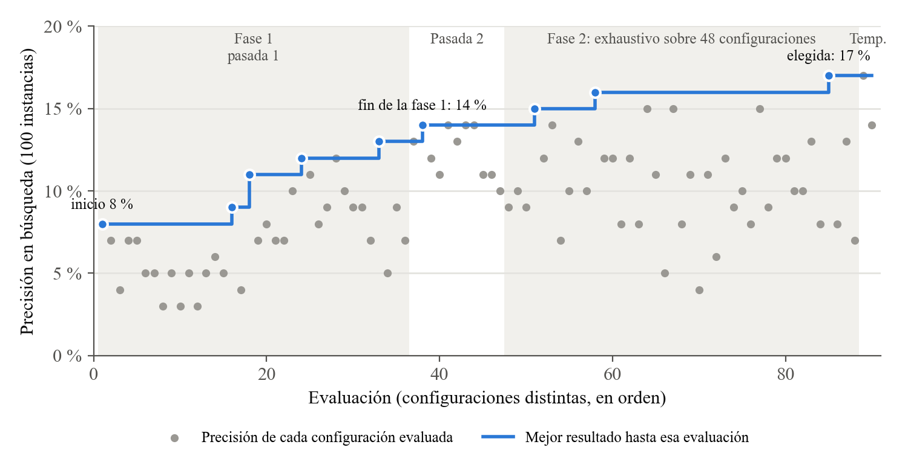
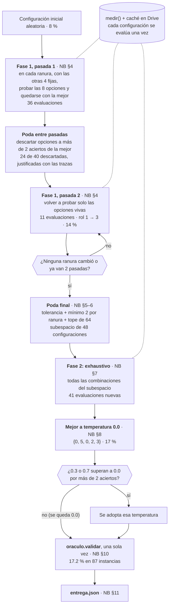

# Proyecto Oráculo — Grupo ADAG1

Análisis y Diseño de Algoritmos · 2026-B · Universidad de Caldas

| | |
|---|---|
| **Subproyecto** | 1 — Proyecto Oráculo: configuración de prompt con un oráculo |
| **Grupo** | ADAG1 |
| **Integrante** | Tania Botina |
| **Versión** | Primera entrega, solución base (semana 2), rama `main` |
| **Repositorio** | https://github.com/tbotina/ADA-2026-2-GP01 (fork de [JuManoel/ADA-2026-2-GP01](https://github.com/JuManoel/ADA-2026-2-GP01)) |

El problema es elegir, entre 32 768 combinaciones de instrucciones (5 ranuras con 8 opciones cada una) y 3 temperaturas, la configuración de prompt que hace que un modelo de lenguaje cumpla más restricciones de formato. Cada configuración se mide consultando un oráculo, y cada consulta cuesta unos 3 minutos de GPU. El enunciado, las reglas del juego y la API del oráculo están en [README_curso.md](README_curso.md).

## Resultado de esta entrega

| Ranura | `rol` | `estrategia` | `formato` | `estilo` | `cierre` | `temperatura` |
|---|---|---|---|---|---|---|
| **Índice** | 0 | 5 | 0 | 2 | 3 | 0.0 |

| Lote | Precisión |
|---|---|
| Búsqueda (100 instancias) | **17.0 %** (17/100) |
| Validación con `oraculo.validar` (87 instancias) | **17.2 %** (15/87) |

Es la **mejor configuración observada** en 90 evaluaciones (0.27 % del espacio), no un óptimo garantizado: la búsqueda es heurística y la poda, empírica. Como referencia, una configuración al azar da menos del 5 %, y la inicial de esta búsqueda daba 8 %.



Puntos grises: precisión de cada configuración evaluada, en orden. Línea azul: mejor resultado hasta esa evaluación.

La heurística corresponde al punto 4 del notebook del curso, pero está en su propio notebook: [`notebooks/busqueda.ipynb`](notebooks/busqueda.ipynb). `proyecto_oraculo.ipynb` queda como lo entregó el curso, con su búsqueda aleatoria de ejemplo.

**Método**, en dos fases (detalles en el notebook de búsqueda y en el [manual técnico](MANUAL_TECNICO.md)):

1. **Ascenso por coordenadas** con dos pasadas. Entre las pasadas se descartan las opciones que, según las trazas de fallos, dañan la respuesta (3 o más aciertos por debajo de la mejor de su ranura).
2. **Búsqueda exhaustiva** sobre el subespacio que sobrevive a la poda: 48 configuraciones.

Después se prueba la temperatura sobre la mejor configuración y se valida una sola vez.



«NB §k» es la sección de `notebooks/busqueda.ipynb` donde se ejecuta cada paso.

## Estado: solución base

Esto es la **solución base** de la primera entrega, no una solución terminada. Para las entregas siguientes quedan:

- el algoritmo exacto (backtracking con poda) y su función de complejidad $T(n)$, semanas 5–6;
- una heurística con cota de calidad, semanas 7–8;
- la experimentación y las variantes, semanas 9–11;
- el simulador sintético del modelo del enunciado, para medir sin GPU.

## Estructura

| Archivo | Qué es | Autor |
|---|---|---|
| `entrega.json` | Configuración entregada: grupo, semana y config | Grupo |
| `notebooks/busqueda.ipynb` | Búsqueda completa: método, registro de evaluaciones, análisis de trazas y validación. Guardado con sus salidas | Grupo |
| `notebooks/registro_evaluaciones.csv` | Las 90 configuraciones evaluadas, con su precisión en búsqueda | Grupo |
| `notebooks/evaluacion.ipynb` | Carga `entrega.json` y la evalúa sin editar nada. Guardado con sus salidas | Grupo |
| `pruebas/probar_entrega.py` | Pruebas locales: validez de `entrega.json` y coherencia entre archivos | Grupo |
| `pruebas/probar_busqueda.py` | Pruebas del algoritmo: ejecuta la búsqueda contra oráculos falsos con resultado conocido | Grupo |
| `figuras/curva_busqueda.png`, `figuras/generar_curva.py` | Curva de la búsqueda y el script que la dibuja desde el registro | Grupo |
| `MANUAL_TECNICO.md` | Manual técnico de la solución base | Grupo |
| `oraculo.py`, `ayudas.py`, `datos_visibles.json` | Oráculo (caja negra), utilidades y datos del curso | Curso |
| `proyecto_oraculo.ipynb`, `README_curso.md` | Notebook y README originales del curso | Curso |

Los notebooks no usan las copias locales de `oraculo.py`, `ayudas.py` y `datos_visibles.json`: las descargan en Colab desde el [repositorio del curso](https://github.com/DanielMelo404/Proyecto-Oraculo-AyD).

## Requisitos

**Notebooks:** Google Colab con **GPU T4**. Se usaron Python 3.13.16, torch 2.11.0+cu130 y transformers 5.22.1, con el modelo `qwen17b` (`Qwen/Qwen3-1.7B`). La celda 1 de cada notebook instala el resto:

- bitsandbytes ≥ 0.46.1, accelerate, nltk, spacy con `en_core_web_sm`, emoji, langdetect e immutabledict;
- `open-instruct` (verificador de restricciones), clonado de GitHub;
- pandas, que ya viene en Colab.

**Pruebas locales:** Python 3.8 o superior, sin GPU. `probar_entrega.py` usa solo la biblioteca estándar; `probar_busqueda.py` necesita además pandas. Para volver a dibujar la curva (`python figuras/generar_curva.py`) hace falta además matplotlib.

## Cómo ejecutar

### 1. Ejemplo pequeño, sin GPU (menos de 1 s)

```
python pruebas/probar_entrega.py
```

Ejecuta 12 pruebas, y todas deben terminar en `ok`:

- `entrega.json` es válido: campos, tipos, índices de 0 a 7 y temperatura permitida;
- el validador rechaza configuraciones que violan las restricciones del problema: índice 8, temperatura 0.5, ranura faltante;
- la configuración de `entrega.json` es la misma que eligen el notebook de búsqueda y el registro, y la que documenta el notebook de evaluación.

Para verificar el algoritmo:

```
pip install pandas
python pruebas/probar_busqueda.py
```

Ejecuta 18 pruebas en unos segundos. Corren el código real del notebook contra oráculos falsos y comparan con el resultado esperado:

- **reproducción de la corrida real:** con los aciertos del registro, debe recorrer las mismas 90 configuraciones y elegir `{0,5,0,2,3}`;
- **sin interacción entre ranuras:** debe hallar el óptimo global (100 de 100, calculado por fuerza bruta);
- **con interacción:** la fase 1 queda en un óptimo local (29) y la fase 2 llega al óptimo (45);
- **límite de la poda:** muestra un caso en que se pierde el óptimo (35 frente a 45), porque el método no lo garantiza;
- **reglas de la búsqueda:** presupuesto, temperatura, validación única y determinismo.

### 2. Evaluar la configuración entregada (~10 min)

[](https://colab.research.google.com/github/tbotina/ADA-2026-2-GP01/blob/main/notebooks/evaluacion.ipynb)

1. Entorno de ejecución ▸ Cambiar tipo de entorno ▸ **T4 GPU**.
2. Ejecutar la celda 1 y luego Entorno de ejecución ▸ **Reiniciar sesión**.
3. Entorno de ejecución ▸ **Ejecutar todo**.

El notebook baja `entrega.json` de este repositorio, lo valida y evalúa la configuración sobre las 87 instancias de validación, que hacen de conjunto de prueba del grupo: no se usaron para buscar. La evaluación sobre los datos privados la hace la profesora aparte, con `entrega.json`. **Resultado esperado:** **17.2 % (15/87)**. Con temperatura 0.0 la generación es determinista, y el notebook compara el resultado con este valor en su última sección.

### 3. Repetir la búsqueda (≈ 4.7 h de GPU sin caché)

[](https://colab.research.google.com/github/tbotina/ADA-2026-2-GP01/blob/main/notebooks/busqueda.ipynb)

Los pasos son los mismos que en el punto anterior; el notebook pide acceso a Google Drive para guardar la caché del oráculo. Si Colab se desconecta, se vuelve a ejecutar todo: el recorrido es determinista y lo ya evaluado sale de la caché en 0 s. El cupo gratuito de GPU de Colab puede no alcanzar para una corrida completa en una sola sesión.

## Reproducibilidad

- **Semillas fijas:** `SEMILLA = 2026` para la configuración inicial y semilla 1 para el oráculo. Las evaluaciones van con temperatura 0.0, es decir, generación determinista.
- **Parámetros del oráculo fijos:** `lote=32` y `presupuesto=64_000_000`, porque lotes de distinto tamaño pueden cambiar levemente las salidas en fp16.
- **Resultados esperados:** en búsqueda, 17 aciertos sobre 100. En validación, 15 sobre 87; este valor se reprodujo en una sesión de Colab distinta, sin caché.
- La validación usa la misma distribución de instancias que la búsqueda. El test privado de la profesora trae familias de restricciones nuevas, así que su resultado puede diferir.
